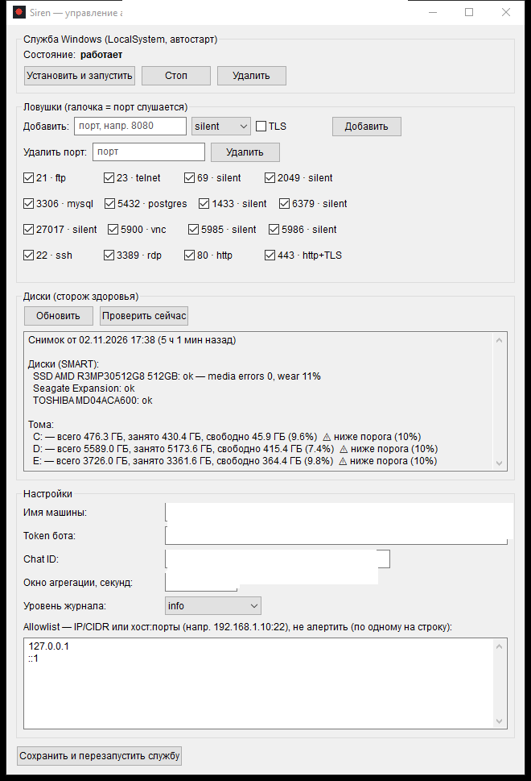

# Siren — для тех, кто не много параноик... сирена-приманка для домашней сети

Программа предназначена, чтобы мы могли мониторить свои ресурсы, что в них ходите
только вы, или видите заходы других людей, ставится на linux/windows, т.е. если вы 
входите, вам приходит уведомление в телеграм, что выполнен вход с такого то ip, 
такой то пользователь, и если это сделали вы, то для вас это новостью не будет, и
если это сделали не вы, то это повод вспотеть...  
Так же хочется знать, что если в вашей сети кто то сканирует компьютеры на открытые 
порты, с какой целью он это делает...
И раз утилита висит в памяти, то почему бы ей не мониторить, что диски в порядке,
ставить для этого отдельно софт или лень, или руки не доходят, а тут странный комбайн,
но всё что нужно... 
**Siren** — honeypot-агент для Windows и Linux: слушает порты-ловушки, следит за
входами по SSH/RDP на настоящие сервисы и немедленно присылает алерты в
Telegram. Внутри — сторож здоровья дисков по SMART.

Проект однопользовательский по духу: один бинарник, один конфиг, никакого
веб-интерфейса и базы данных. Всё поведение зафиксировано исполняемыми
спецификациями OpenSpec (`openspec/specs/`).

```
        подключения              факты входов              здоровье дисков
  сканер ---> [ловушки 21/22/   journald / Windows   --->  [сторож здоровья]
               23/3306/5900]    Event Log (SSH/RDP)        SMART-счётчики,
                    |                 |                      место на томах
                    v                 v                            |
                    +--------> [обогащение: ARP, имена] <----------+
                                       |
                            [allowlist: кого не алертить]
                                       |
                            [агрегация всплесков]
                                       |
                                 Telegram-алерты и дайджесты
```

## Что умеет

- **Ловушки-порты** — эмуляторы сервисов (FTP, Telnet, SSH, MySQL, VNC и др.):
  любое подключение — это кто-то, кто не должен был сюда стучаться. Алерт сразу.
- **Датчики входов (двери)** — реальные SSH (Linux, journald) и RDP (Windows,
  Event Log 4624/4625/1149): неудачные и успешные входы с внешних адресов.
- **Allowlist** — источники, которым алертить нельзя: IP/CIDR целиком или
  точечно — только заданные порты (`192.168.1.10:22` гасит и ловушку на 22,
  и реальные SSH-входы с этого хоста, но не трогает остальное).
- **Агрегация** — всплеск сканирования схлопывается в один алерт с числом
  событий, итоги дня уходят дайджестом.
- **Сторож здоровья** — SMART-счётчики (realloc/pending/NVMe media errors и
  износ) и место на томах; тревога при росте счётчиков, ежедневный/еженедельный
  отчёт по расписанию.

## Быстрый старт

Пульт управления (Windows, ставится сам, службой):



- **Windows** — скачайте один файл `siren.exe` со страницы
  [Releases](https://github.com/kur890440-ops/siren/releases) и запустите:
  UAC → он сам скопирует себя в `%ProgramFiles%\siren`, создаст конфиг,
  поставит службу с правилом брандмауэра; в пульте останется ввести
  token/chat_id → «Сохранить и перезапустить службу».
- **Linux** — скачайте `siren-linux-kit.zip` оттуда же, распакуйте,
  `sudo ./install.sh`, впишите token/chat_id в `/opt/siren/config.json`,
  `sudo systemctl enable --now siren`.

Подробности и проверка установки — в [docs/deployment.md](docs/deployment.md).

Проверка, что всё живо (со своей машины):

```bash
nc 127.0.0.1 21        # баннер FTP-ловушки -> алерт в Telegram
```

### Сборка из исходников

Нужен Go и PowerShell (Windows): `.\build.ps1 -Version 0.3.0` — бинарники
для обеих платформ появятся в `bin/`.

## Документация

| Документ | О чём |
|---|---|
| [docs/architecture.md](docs/architecture.md) | как устроен конвейер: ловушки, двери, allowlist, агрегация, сторож |
| [docs/configuration.md](docs/configuration.md) | все параметры `config.json` с примерами |
| [docs/deployment.md](docs/deployment.md) | установка, обновление, проверка, эксплуатация на обеих платформах |

Разработка: `build.ps1` собирает Windows+Linux; тесты — `go test ./...`.
Поведение описано спеками в `openspec/specs/` (OpenSpec).

## Лицензия

[MIT](LICENSE)
